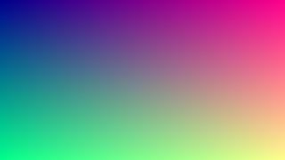

このページはデザインの確認用。本文に出てくる要素を一通り並べてある。公開はしない（`draft: true`）。

日本語の段落。読みやすさを見るための文章なので、意味はあまりない。行間と本文幅、段落の間隔を見る。Astro で作り直したこのサイトは、md を書いて `main` に push するだけで公開される。

## 見出し 2

見出し 2 の直後の段落。見出しと本文の距離、上下の余白を見る。

### 見出し 3

見出し 3 の直後の段落。見出し 2 との大きさの差が分かる程度に。

## リスト

- 項目その 1
- 項目その 2。少し長めの文章を入れて、折り返したときの字下げを見る。折り返したときの字下げを見る。折り返したときの字下げを見る。
- 項目その 3
  - 入れ子の項目
  - 入れ子の項目

1. 番号付きの項目
2. 番号付きの項目
3. 番号付きの項目

## 引用

> 引用の例。少し長めの文章を入れて、折り返しと左の罫線を見る。折り返しと左の罫線を見る。
>
> 2 段落目の引用。

## コード

インラインコードは `bun run build` のように出す。`src/content/blog/` のようなパスも。

```ts
import { getCollection } from 'astro:content';

export async function getPosts() {
  const posts = await getCollection('blog', ({ data }) => !data.draft);
  return posts.sort((a, b) => b.data.date.getTime() - a.data.date.getTime());
}
```

```sh
bun install
bun dev
bun new "タイトル" slug
```

## リンクと画像

外部リンクは [Astro の docs](https://docs.astro.build/) のように新しいタブで開く。内部リンクは [about](/about/) のように同じタブ。



## 表

| 項目     | 決定                    | 備考           |
| -------- | ----------------------- | -------------- |
| 生成     | Astro                   | Shiki で色付け |
| 公開 URL | `https://harvath.tokyo` | GitHub Pages   |
| 道具     | bun                     | Node は固定    |

最後の段落。記事末尾の「前の記事 / 次の記事」との間隔を見る。
